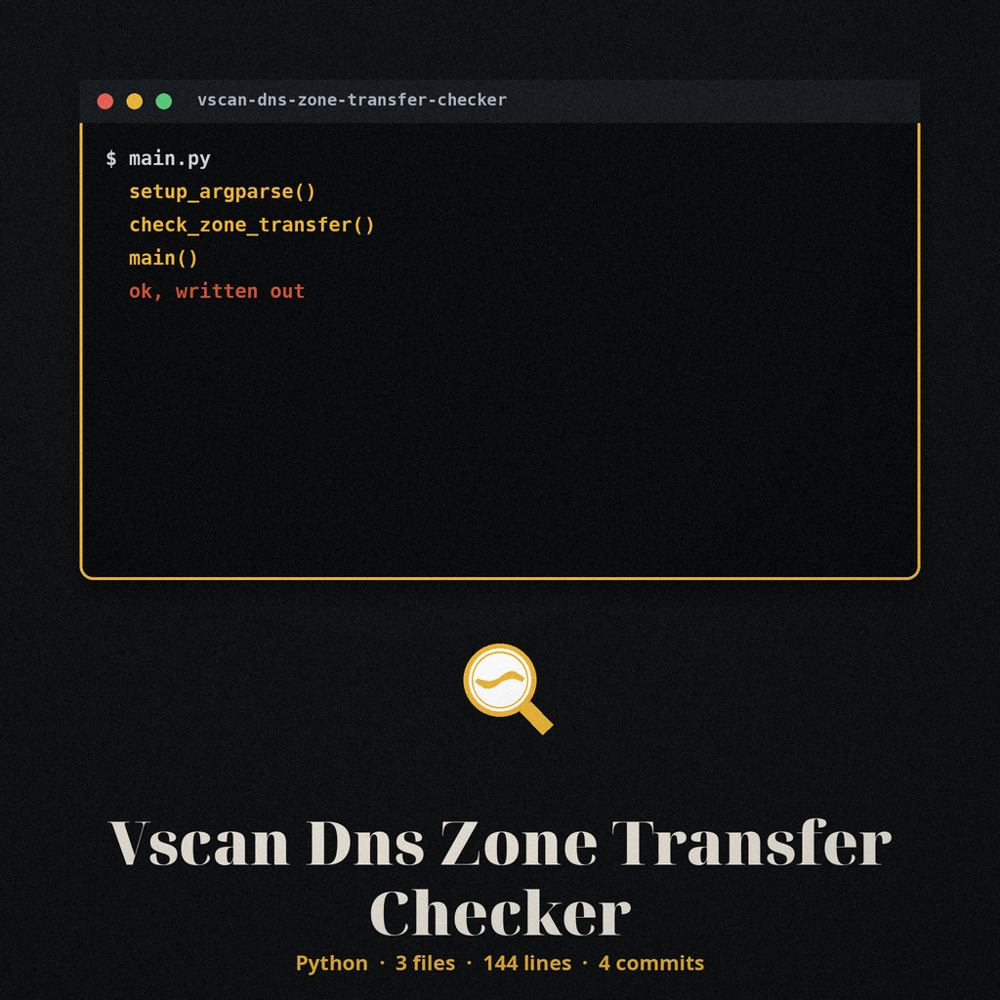
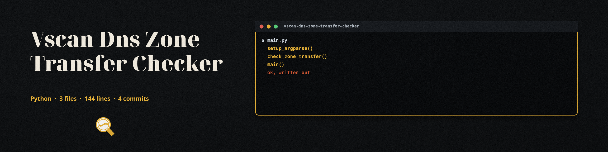

# vscan-dns-zone-transfer-checker

Detects DNS zone transfer vulnerabilities by attempting a zone transfer (AXFR) from a domain's nameservers. Part of a lightweight web application vulnerability scanning collection focused on common misconfigurations.

## How verdicts work

- Transfer succeeds: the zone records are printed and the run reports that a zone transfer vulnerability was found, exit 0.
- At least one nameserver definitively refuses the transfer (or returns a malformed answer) and none succeeds: the run reports that no vulnerability was found, exit 0.
- No verdict: nameserver discovery fails (for example NXDOMAIN, a resolver timeout, or another resolver error), or every transfer attempt times out or errors. A timeout is not evidence that a zone is protected, so the tool prints a could-not-reach-a-verdict line and exits 1 in this case.

When no nameserver is given, nameservers are discovered with an NS lookup through the configured resolver, so in a split horizon setup the discovered set is the set that resolver can see.

## Install

`git clone https://github.com/ShadowGuard-AI/vscan-dns-zone-transfer-checker`

Requires Python 3 with dnspython (see requirements.txt). dnspython is a hard requirement: without it the tool cannot run.

## Usage

`python3 main.py <domain> [nameserver]`

Examples:

- `python3 main.py example.com`
- `python3 main.py example.com ns1.example.com`

## Parameters

- `domain`: The domain to check for zone transfer vulnerability.
- `nameserver` (optional): The nameserver to query. If not provided, the domain's nameservers are discovered automatically.
- `-h`: Show help message and exit.

## License

MIT. See LICENSE.
